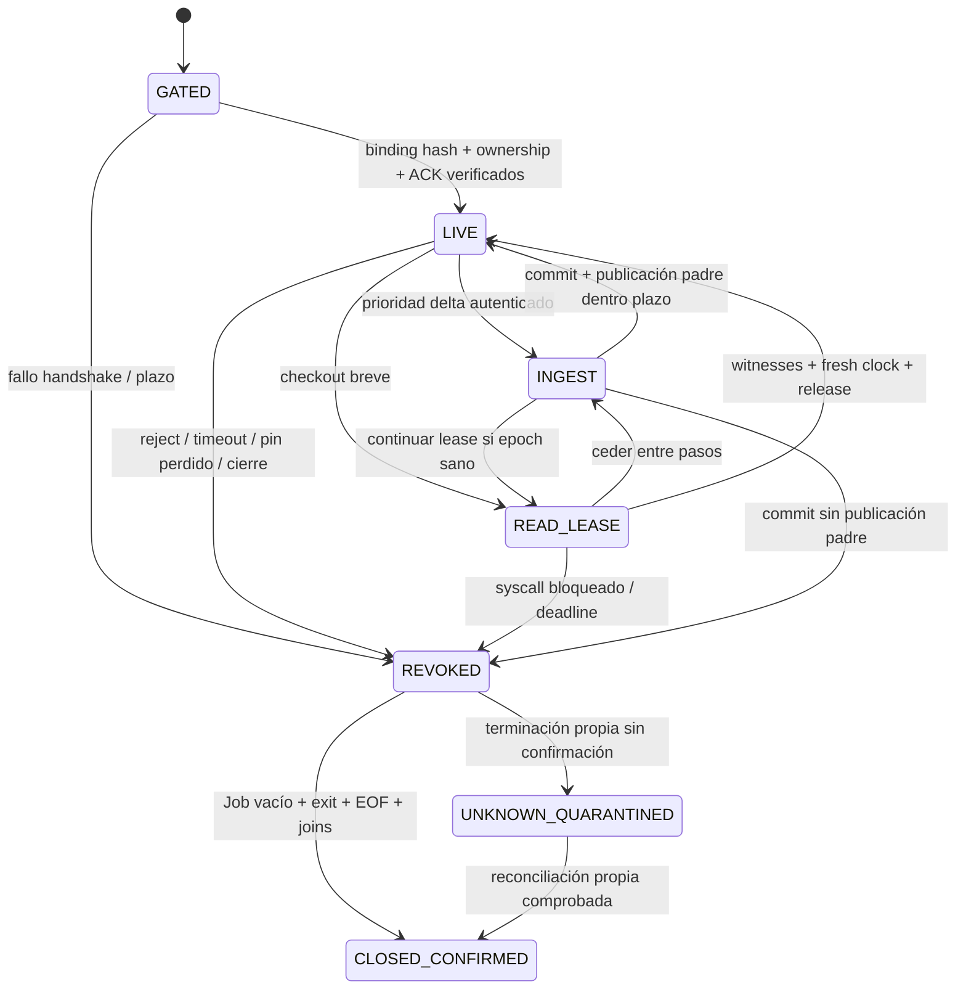
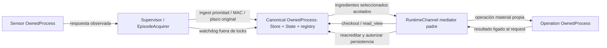

# Diseño privado — integración canónica aislada T09

## 1. Contexto y restricciones

Root eligió O2 el 2026-10-08T00:55:42.675208+00:00 en `root-layout-choice.json`, bajo mandato autónomo explícito. Este refinamiento concreta su arbitraje; el estado borrador describe el contrato de IPC aún pendiente de revisión de root, no reabre el proceso elegido ni las cápsulas O2 de ADR0046. Escritura exclusiva en esta carpeta. TDD n/a, prosa; sin ejecución de producto, pruebas, Python, procesos nativos, GPU, WSL, Ollama, Docker, UI, PDH, red, instalaciones, Git, knowledge, goals o subagentes. Lecturas/hashes y escritura de artefactos privados mediante PowerShell no son una corrida CLI de benchmark. No revertir trabajo concurrente T04 o fases legales web.

Fuentes leídas: CONTINUE-HERE.md vigente, AGENTS.md, CONSTITUTION.md, brief T09, elección root, diseño y receipt anteriores de `canonical-runtime-integration-design`, root-acceptance de `custody-native-qa1` y `canonical-native-qa1`, APIs locales abajo y ADR0042/45/46. Método de `custom-agents/1.22.0/agents/architect.md` y plantilla architect aplicado con las excepciones de ownership/ADR/medidor/decisión indicadas expresamente por este encargo; no atribuir el tier declarativo opus a consumo real. El mapa root enumera 64 fuentes: `protected-before.json` las compara con SHA256 y tamaño, sin importar módulos.

Aceptación anterior limitada: custodia individual Windows 92 PASS/1 skip, whole93,852459% sin exclusiones; canonical transition/state y fold vacío de originales 94 PASS (69+25), whole87,242798% sin exclusiones, 94 pares nacimiento/cleanup. No acredita integración runtime, rowreader, packs/FINAL, T13, cadencia/GPU/13h/160, calibración ni calidad. Cambiar bytes protegidos exige aceptación nueva. Episode81,316348% es evidencia predecesora, no cobertura nueva.

Realidad de API, no nombres inventados como existentes:

| Fuente actual | Contrato observado |
|---|---|
| `scripts/eval/benchmark_process.py` | `OwnedProcess(config,trusted_handler,startup_timeout_s=5)` asigna `WindowsJob` antes del gate; comprueba PID/FILETIME vía `job.evidence(process)`. `call(payload,deadline_ns)` admite sólo operation/arguments, lock no bloqueante, un seq activo; `_child()` ejecuta handler síncrono. `_read` alimenta Queue(MAX_PROGRESS+2). MAX_REQUEST4096, MAX_FRAME262144, MAX_PROGRESS64. `close(graceful=False)` intenta terminación/cleanup propios; no usa call.lock, pero no ofrece hoy arbitraje concurrente seguro de close ni abort con recibo único. |
| `benchmark_canonical.py` | `CanonicalState(root,context,store)` exige instancia exacta CustodyStore. `capture`, `propose`, `commit`, `accredit` serializados por RLock; `commit` hace witness dentro. `accredit` recorre toda historia bajo lock con deadline renovado por witness. `transition` y `validate_accepted` contienen la única semántica. |
| `benchmark_custody.py` | Una instancia crea namespace y pins propios. `capture(entries,deadline)`, `read(ref,name,offset,length,deadline)`, `close`. CapsuleRef sólo en la misma instancia; no import/open-existing/duplicate/export. MAX_ENTRIES128, MAX_CAPSULE64MiB, MAX_READ256KiB. `read` mantiene store RLock durante pin.read. |
| `benchmark_episode.py` | `EpisodeAcquirer.acquire` fija deadline=start+2s, observa call del sensor, construye/valida receipt y publica arrays/predecesor; falta captura canónica previa. Rechazos/interrupciones preservan evidencia y rompen predecesor. |
| `benchmark_coordinator.py` | `ContinuousCoordinator._sample/_custody/run_owned` separan sampler y operación. `RuntimeChannel.operation/transaction` usa RLock; `_audit_delta` manda hasta32 intentos por segmento. No existe RPC inverso del hijo. |
| `benchmark_runtime.py` | `BenchmarkOperationProvider`, config root/plan_path/owner_path/token/supervisor_pid/audit_binding_path/sha256. `validate_delta`, audit_validate, calibration_export, accreditation, refresh_accreditation, row releen originales o llevan snapshot acumulado. |

No transportar handles ctypes ni copiar/importar refs. Store, state, registry y leases viven juntos en el hijo canónico conocido, distinto del sensor y del worker de operaciones largas. Ningún servicio permanente o infraestructura de cola nueva; las colas propuestas son internas al canal de esta sesión.

## 2. Opciones de arbitraje dentro de O2

| Enfoque concreto | Complejidad | Riesgo | Coste relativo | Reversibilidad |
|---|---|---|---|---|
| A: multiplexado opt-in del OwnedProcess existente; lector de entrada separado y scheduler cooperativo único de I/O canónico | Alta: demultiplexado y continuaciones tipadas | Un syscall bloquea ambos carriles, pero padre puede terminar Job; no hay competencia nativa por handles | M | Se retira el modo opt-in; legacy intacto |
| B: dos hilos handlers con prioridades usando el store/state actuales | Media aparente; alta al corregir locks | Ambos esperan store RLock o accredit; dos calls actuales se rechazan; prioridad del hilo no interrumpe kernel. No satisface ingreso independiente | M | Sencilla, pero inadmisible sin rediseño equivalente a A |

A recomendado. Usar un segundo pipe o un lector auxiliar sin cambiar dispatch serial tampoco resuelve B. Separar custodia en otro proceso exigiría handles/autoridad duplicada y contradiría este layout. No se propone.

## 3. Criterios de decisión

1. El ingreso no espera la finalización de una auditoría ni el lock de RuntimeChannel, call, state o store; admisión es sólo frames tipados y memoria acotada. La ejecución nativa puede esperar como máximo el paso de lectura ya en curso, incluido en deadline original. Un syscall arbitrariamente bloqueado invalida la sesión.
2. Una única instancia de custodia y una única transición semántica; ningún cambio de política, umbral o plazo. O(delta) sólo para payload nuevo/semántica; witness de prefijo sigue lineal, con cero payload histórico.
3. Revocación padre inmediata y terminación del Job conocido independientes del audit caller. Performance/cadencia se aceptan sólo con pruebas nativas actuales.

## 4. Contrato recomendado de O2

### 4.1 IPC y prioridad exactos (todo lo nuevo es propuesta)

Extender `benchmark_process.py` con modo gate `canonical_mux_v1`, exclusivamente para la factoría allowlisted propuesta `benchmark_canonical_runtime:CanonicalProvider`. Sensor y operation worker mantienen `call` legacy. Añadir fachada propuesta `CanonicalChannel` en `benchmark_canonical_runtime.py`, construida desde OwnedProcess con este modo; `submit_ingest`, `request_view`, `finish_view`, `revoke`, `close` son métodos NUEVOS, no calls actuales ficticios.

El padre usa un writer dedicado de frames y el reader real extendido para demultiplexar `(epoch,lane,seq,index)` a esperas separadas. El lock de escritura cubre sólo un frame; ningún waiter/audit retiene ese lock. Preparar encode fuera del lock. Reader y writer no ejecutan custodia ni auditoría. Nunca confiar en que un write de pipe es interrumpible: watchdog no espera writer ni reader para emitir terminación del Job. Tras abort, ningún envío nuevo y las esperas fallan por epoch revocado.

El hijo opt-in lee stdin en hilo separado, valida esquema/tamaños/secuencias y admite a dos slots acotados. Scheduler de handler toma siempre ingest completo pendiente antes del siguiente paso de lectura. Ingest no queda detrás de un read completo. Read es continuación, no `handler()` que recorra toda historia: checkout breve; un witness por paso; selección por ordinal en bloques de hasta32; un frame de ingredientes por paso; reacreditación final breve. Entre pasos consulta ingest/revoke. Un witness puede invocar varios syscalls actuales; NO se afirma cota temporal del paso por limitar bytes. Si está bloqueado el padre termina el proceso entero. No usar Future.cancel como prueba de cancelación.

Límites propuestos de admisión, sin ampliar constantes actuales: un ingest activo o pendiente (sampler único); un read-view/lease activo; un siguiente frame por carril pendiente, sin backlog de reads; cola de salida dos frames (uno por carril), acumulador por transferencia <=64Mi caracteres; frame entrante<=4096 bytes y saliente<=262144 bytes, fragments de texto<=1200 caracteres; máximo64 progress por seq como hoy. Las colas llenas rechazan, no bloquean al hilo de ingreso ni descartan silenciosamente. Retransmisión/índice repetido/seq no creciente falla cerrado. Ingest_begin/fragment/end usa el slot ingest durante toda transferencia: read puede ceder, no consumir ese slot. Tamaño del objeto cerrado se calcula antes de begin; intento indivisible que excede límites se rechaza. Control revoke en padre no requiere llegar a esa cola. Todos estos números son caps de protocolo propuestos/constantes conservadas, no rendimiento medido.

Sólo el scheduler hace capture/propose/commit/store.read y close normal. Por ello el store actual conserva su lock nativo y la protección aceptada sin threads rivales; el scheduler no deja un lease sosteniendo ese lock. No es necesario quitar locks de CustodyStore. Root debe autorizar una extensión protegida de CanonicalState: `checkout()` toma snapshot/registrations inmutables y lease; `witness_step(lease)` valida una registration fuera del breve state lock; `finish_accredit(lease)` comprueba epoch/quarantine/interruption y valida frescura actual antes de emitir ref; `release(lease)`. Todos son NUEVOS. Reutilizar `_witness` y `validate_samples`; `accredit()` actual pasa a wrapper secuencial sobre esos pasos para compatibilidad. Ninguna renovación de2s por witness: toda read-view lleva deadline absoluto propio, incluso waits; nunca consume un nuevo presupuesto de episodio.

Una lease no es un token externo aceptado. Conserva pins hasta cierre; un head nuevo sano no invalida el prefijo del checkout, pero rechazo/interrupción/pérdida de autoridad revoca todas las leases. Un cambio de epoch, registro o pin hace fallo global. Finish devuelve sólo cursor del checkout, jamás cursor posterior. Close normal sólo libera refs tras release; abort no espera leases ni state/store lock: termina Job y declara cuarentena hasta cleanup confirmado.

### 4.2 Wire tipado y bootstrap de confianza

Esquemas cerrados, rechazar campos desconocidos y tipos bool donde se exige int. Envelopes NUEVOS conservan operation/arguments y límites encode/decode existentes, añadiendo binding/carril al modo opt-in. No ampliar gate4096: poner configuración extensa en un archivo sellado de bootstrap, como audit-transport-binding actual, con ruta/hash fijados por config del supervisor antes de admitir RPC.

| Acción tipada | Datos permitidos y resultado |
|---|---|
| bootstrap gate | `mode,handler,config` fija ruta/hash del binding; binding cerrado contiene root/context/stream/epoch, supervisor PID/FILETIME, sensor ownership observado, canonical ownership esperado y operation worker ownership tras bind. ready observado por padre, challenge/ACK ligado al seq de bootstrap y ownership real antes de LIVE. |
| bind_operation | Una vez, desde supervisor autenticado: ownership observado del operation OwnedProcess; registrar request namespace y tipos autorizados. No caller replacement. |
| ingest_begin/fragment/end | transfer_id, epoch, attempt_ordinal, characters, digest; fragment index/text; end cerrado. Contenido: ancla congelada del supervisor, inventory de SourceEntry relativos al episode propio y record candidato. trusted_attempt procede del registro de ingreso autenticado, no de un segundo campo JSON caller. Resultado: committed cursor/prefix/attempt_id y digest de original receipt; sin samples aceptados hasta publicación externa. |
| read_view_begin/next | kind row/calibration/prerequisite/refresh/status, operation_request_id, worker binding, cursor/prefix emitidos, selector de ordinal validado contra registro de operación propio, deadline absoluto. Resultado frame header + ingredientes seleccionados, índices exactos y hashes de segmento; next exige lease/seq/index exactos. |
| finish_view/release | lease privado, seq; child vuelve a validar epoch y reloj actual y emite ViewRef registrado; release idempotente para dueño exacto, no foreign. |
| ingest_publish | Paso de prioridad ingest para el mismo transfer_id/ordinal: ancla externa congelada por padre, reloj observado de commit, digest receipt y cursor/prefix exactos; child persiste exclusively y devuelve seal/ACK. No acepta paths ni un commit distinto. View registry conserva head tentativo hasta confirmación externa autenticada; no emite referencias a él. |
| revoke/close | reason, epoch, seq; revoca registry, no nuevos effects; ACK informativo. Parent abort/cleanup sigue siendo autoridad aunque el ACK no llegue. |

HOW de procedencia: el supervisor posee los Popen/Job originales del sensor y canónico, observa la respuesta completa y `job.evidence(process)` real (incluido PID/FILETIME), y congela el resultado. El bootstrap hash confiado NO viene de request ni de selfcapsule. El canal stdin privado lo crea ese supervisor, tras asignación del Job; ningún API caller recibe su writer ni el binding secreto de sesión. Para admitir anclas, añadir autenticación por MAC de los bytes de cada envelope con nonce de sesión generado en supervisor y fijado en el gate (no en archivos de evidencia ni logs), ligado a epoch/lane/seq/ordinal/context y hash del binding. Verificación en child antes de filesystem; no asumir que PID en JSON prueba senderownership. El ACK enlaza nonce de challenge/ownership canónico y padre comprueba ownership observado actual. Este modelo confía en código supervisor/OS local, no protege contra otro proceso con permisos para leer su memoria; no presentarlo como aislamiento de usuarios del host.

Registro interno del child mantiene anclas autenticadas independientes del payload de cápsula. Resuelve `trusted_attempt` desde allí y lo compara con attempt mediante API real; cap caller que duplica attempt como trusted_attempt no llega a esa API. Root/paths/context/autorecibo jamás crean registro. El sensor no tiene MAC ni writer canónico. Worker de operaciones tampoco emite anchors ni se comunica inversamente. Boot/config/hash/challenge/ownership alterados: no LIVE, sólo cleanup Job propio y failclosed.

ViewRef externo propuesto: `schema,kind,token,stream,epoch,worker,operation_request_id,cursor,prefix,context_sha256`. Token aleatorio registry interno emitido sólo después de commit y finish_accredit con fresh clock. Visible JSON no acredita nada. Lookup exacto exige todos campos/type/selector y estado; token extranjero/autofabricado, epoch anterior, worker cambiado, raíz/context distintos, cursor/prefix falso, replay de efectos ya consumidos falla ANTES de I/O/API/lease/persistencia. Un next de transferencia es secuencia consumible; un status nuevo genera acreditación nueva, no replay del resultado. MAC no convierte un token caller en autoridad.

Detalle de bootstrap sin circularidad de nacimiento: config/hash prebound inicial conoce sensor y supervisor, pero el PID/FILETIME canónico nace dentro de OwnedProcess.__init__. El challenge autenticado posterior al ready aporta ese ownership observado REAL y lo fija una sola vez antes de LIVE. No declarar que el constructor actual puede meter anticipadamente ese PID en un archivo sellado. bind_operation se completa sólo después del nacimiento observado del operation worker; hasta entonces no existen tickets de operación. ACK firmado liga estas identidades con el binding inicial. Handler/canal opt-in allowlisted rechaza modo o factoría caller.

### 4.3 Episodio, publicación y reloj único

El deadline original de `EpisodeAcquirer.acquire` incluye espera/IPC del sensor, construcción del recibo, staging, espera al scheduler, capture, validación transition, witness commit, respuesta, verificación padre y publicación externa. No añadir2s al retornar sensor. Conservar reservas actuales de100ms y cleanup presupuestado; la aceptación requiere completar antes del deadline original, no sólo antes de empezar capture.

1. Padre observa sensor real y congela receipt final ORIGINAL antes de captura (incluidos observed_utc/monotonic). Congela request/attempt y RAW/progress sin reserializar esos originales. No seguir cambiando observed después del hash.
2. Staging de `supervisor-receipt.json` y `supervisor-inventory.json` NUEVOS: child canónico, en episode namespace cerrado/propio prebound, escribe exclusivamente bytes entregados por supervisor autenticado dentro del restante original. Inventario evita autorreferencia: enumera originales + receipt; metadatos de inventario son entrada de índice de cápsula, no su propio hash circular. Su ancla/digest externo es registro supervisor independiente. Closed names, seals/lengths, límites, enlaces y paths se verifican antes de capture; ninguna ruta elegida por consumer.
3. Child ejecuta state.capture/propose/commit con esa ancla separada y transition única. Commit nativo no publica arrays del padre. Prefix payload viejo no se reabre; witness cero bytes lineal declarado. Indexa de bytes del delta validados: attempt ordinal, accepted sample index, receipt seal, phase/stream, idle, phase_started_utc, raw_ref_count, acquisition clocks y estado interrupted/rejected. No releer prepared para índices o breaks.
4. Padre recibe frame completo, comprueba canonical Job/PID/FILETIME, MAC/seq/epoch/cursor/prefix/original receipt digest y reloj propio actual; prepara/publica ancla externa de finalización, separada del recibo congelado. Sólo después actualiza last_record/receipts/previous_receipt/attempts y coordinator arrays. La ancla de finalización referencia commit/cápsula y receipt, nunca entra retroactivamente en su hash.
5. La escritura duradera de la ancla externa puede bloquear igual que cualquier I/O padre. Para evitar introducir esa llamada nativa en sampler, staging de external-publish anchor se hace en el mismo child bajo reloj original, y padre congela primero su reloj de observación de commit y después observa el ACK de persistencia con su reloj final. El registro en memoria del supervisor conserva ambos clocks y el seal del anchor; FINAL recibe ese inventario externo por hash custodiado por root, no por selfmanifest. El completion clock posterior no se autoescribe en su propio archivo: es una segunda ancla externa de supervisor en memoria/final audit. Publicación en memoria va tras ACK y último deadline check; no se promete atomicidad física de disco. Ambos pasos IPC son ingest priority y caben sólo en restante, no nueva ventana.
6. Si commit ocurrió pero ACK/persistencia/publicación padre falla o llega tarde: revoke epoch, quarantine, ninguna aceptación en arrays; RAW/cápsula/evidencias retenidas y predecesor roto. Commit físico online no es aceptación externa. FINAL compara anclas externas y clasifica este caso interrupted, no accepted por encontrar commit. Rejected/interrupted nunca se rehabilita por capture tardío. Si se puede inventariar dentro restante se usa transition de estado rechazado/interrumpido; agotado el plazo sólo evidencia parcial y pérdida de autoridad, posteriormente FINAL desde vacío. Contadores ordinal/raw no se resetean.

Watermark de publicación: commit sólo avanza head tentativo; ingreso mantiene barrier para views del nuevo head. El padre guarda el completion clock final y su ancla en registro propio después del ACK de ingest_publish y del deadline check, antes de arrays. Una read_view sólo puede promover el watermark si trae la confirmación de ese registro de publicación externo, autenticada por el mediator, cuyo clock final debe ser anterior al deadline original y cuyo receipt/commit/ordinal deben coincidir. No se permite aportar esa confirmación desde operation args/caller. Sin ella, read devuelve sólo prefijo publicado anterior si sigue sano, o falla, nunca acredita el tentativo. Mediator obtiene anclas publicadas bajo copia breve de coordinator.condition después de acquire, no del estado tentativo child. Así la promoción no requiere otro round-trip antes de publicar arrays ni habilita recursos fantasma en la ventana commit/parentfailure. Una pérdida posterior revoca epoch y tickets previos antes del siguiente efecto; el watchdog padre sigue siendo independiente de esa condition.

### 4.4 Watchdog, cierre y estados

Añadir a OwnedProcess mecanismo opt-in `abort_owned(reason)` con un control de lifecycle separado, de sección breve, que marca closed/revoked y reclama una única ejecución de terminación. No adquirir call.lock, writer lock, RuntimeChannel.transport, coordinator.condition, state lock o store lock. Watchdog conoce deadline antes de submit; usa `WindowsJob.terminate` del Job cuya ownership se guardó al nacimiento, no búsqueda por nombre/PID suministrado ni kill de otro worker. Close/reaper concurrentes comparten el recibo único de cleanup; call legacy en error no inicia un segundo cleanup. El lifecycle lock nunca cubre wait/join/pipe I/O/kernel. Un error al verificar ownership revoca, no sustituye el Job por uno caller.

Separar decisión failclosed de confirmación de recursos: epoch revocado impide efectos inmediatamente; recursos retornados sólo tras process exit/signalled, EOF y reader/writer join, miembros propios signalled y Job.active()==0 con evidencia ligada al ownership original. Si kernel/cleanup no retorna, retain UNKNOWN_QUARANTINED en registro supervisor; no borrar artefactos ni declarar resources_returned=true por Future.cancel o PID ausente. No esperar child `lose_authority` bajo lock para revocar padre. Benchmark/coordinator `_fail` interrumpe observación, worker operación usa recuperación existente de ADR0045; canonical watchdog termina sólo canonical Job. No afirmar continuidad del sampler una vez perdida custodia. No repetir POST/create incierto.

No transición de cuarentena a LIVE. Reinicio crea IDs/epoch/tokens nuevos; restore tipado no existe y sigue fuera de aceptación.

### 4.5 RuntimeChannel, rows y prerequisites transitivos

RuntimeChannel mantiene su RLock para operaciones materiales, pero sampler usa CanonicalChannel separado y no entra en ese RLock. Mediator decide acciones semánticas audit/calibration/accreditation/refresh/row en padre; long create/start/source_check/API/output processing siguen en BenchmarkOperationProvider. No callback desde operation child. Parent selecciona selector desde registro de runs/fases propios, no from args arbitrarios. No transportar history/offline_samples/RAW completo a operation worker ni un selfmanifest con autoridad.

View de row contiene sólo baseline seleccionada y rango de run, índices de sample/attempt, phase/idle/start/raw_count y continuidad del prefijo. Frames bounded y digest encadenado; hasta32 registros por segmento y un registro indivisible<=MAX_FRAME. Al agotarse cap de objeto no se devuelve todo historial: avanzar frames y cálculo incremental equivalente a summarize_run; hashes/seq de frames completos, sin acumular indefinidamente en padre/child. Cada rango debe comprobar orden único, extremos existentes y indices sample vs ordinal: rejected no desplaza accepted index silenciosamente. La fila combina métricas conservando timings/shared_assessment/spill/errors; raw_count>1 produce breaks sin prepared histórico.

Operation child `row_material` NUEVO lee request/terminal/estimate propios, `verify_outputs`, fidelity y outputs como hoy, y devuelve material seal/binding de mismo operation_request_id y su ownership real. Parent verifica frame, ownership actual, request/run/folder seals y el selector propio; calcula con helper puro extraído de summarize_run compartido, sin revalidar prefix. Antes de persistencia exige finish_view nuevo con reloj actual (0<=edad<=900) y epoch válido. Child `row_persist` NUEVO acepta sólo ticket del mediator ligado a row digest, folder propio, operation request, worker epoch/cursor/prefix/type y seq one-shot. Caller `validated=true` no es vía alternativa. Parent observa ACK y revalida authority/clock antes de devolver fila aceptada; si falla, archivo se conserva como candidato no aceptado, ancla externa no acredita resultado. No claim de atomicidad entre pérdida de autoridad y escritura: sólo efectos con ticket vivo y final publish vivo son aceptados.

Resolver TODAS estas ramas live, sin bypass global: runtime `validate_delta/audit_validate/calibration_export/accreditation/refresh_accreditation/row`; coordinator `_audit_publications/_audit_delta`; runner `summarize_run/validate_prerequisites`; observation `accepted_samples/read_acquisitions/validate_auto/build_auto_prerequisites/validate_calibration`; calibration_v3 `select_phases`; benchmark `run_session_v3` y wrappers/entradas inyectadas. Lectores offline conservan branch de originales y validate_accepted/transition única. Helpers nuevos reciben `ResolvedView` interno generado por mediator/registry verificado; JSON parecido nunca crea esa clase autorizada. Preservar source/lock/viewport checks y validate_lifecycle; exactos diez baseline/loaded/unloaded, orden, receipt seals, phase stream/idle/phase_started_utc y umbral512. Reloj externo actual en child finish y padre antes de cada publish, incluso status/refresh sin datos. `audit_status` cacheado sólo es posición, no validación.

Propuesta concreta de representación compacta compatible para root: conservar esquema de evidence.publications sellado/path existente; su contenido actual ya es referencia acotada (R09-T10 overflow refutado). Añadir campo opcional `canonical_view` en documento publications, con discriminator `canonical_publications_v1`, stream/epoch/context_sha256/cursor/prefix y receipt de ancla externa; no sustituir ni autorizar desde esos campos. Live resuelve con registry, offline con originales/anclas. Añadir opcional `renewal_base` como referencia sellada a acreditación BASE inmutable; cada refresh apunta directamente a esa base y a una publicación nueva, sin previous_accreditation anidado creciente. Legacy `previous_accreditation` mantiene lectura y guardas cycle/depth16; prohibir ambas formas simultáneas, selfref, base que sea renovación o resolución fuera scope. Validator nuevo permite sólo los campos opcionales enumerados, conservando exigencias actuales. Base se valida en bootstrap y pins propios; cada uso revisa custodia, contexto y fresh900 externo, no importa aprobación pasada. Cambio de evidencia debe publicarlo root en ADR aditivo y docs afectados; este diseño recomienda esa forma sin consultar al propietario ni fingir ya aprobada/implementada. Mantener regresión positiva bounded-ref, no falso RED de overflow.

## 5. Impacto en módulos y ficheros / handoff acotado

Estas son responsabilidades de implementación propuestas, no tasks ni presupuesto ni permiso de editar aquí. Ningún fichero se ha cambiado fuera de esta carpeta.

| Fuente propuesta | Responsabilidad exacta / dependencia |
|---|---|
| Nuevo `scripts/eval/benchmark_canonical_runtime.py` | CanonicalProvider, CanonicalChannel, schemas/MAC/binding, scheduler continuations, view registry/tickets, parent anchor freeze/revoke; sin backend GPU/API. |
| `scripts/eval/benchmark_process.py` | OwnedProcess init/_read/call/close y _child opt-in multiplex gate/demux; abort_owned lifecycle único, queues/frame enforcement; protocol legacy assertions intactos. |
| `scripts/eval/benchmark_canonical.py` | Additive checkout/witness_step/finish_accredit/release; accredit wrapper común; índice de selección delta validado y lease epoch. capture/propose/commit/transition/validate_accepted sin segunda semántica. |
| `scripts/eval/benchmark_custody.py` | Reusar capture/read/close íntegros. Ninguna API de import/handle. Si una prueba obliga modificar nativeI/O, requiere ownership nuevo expreso y whole EACH nueva; no ocultar en adapter. |
| `scripts/eval/benchmark_episode.py` | EpisodeAcquirer init/acquire/close: freeze receipt, ancla separada, ingest antes arrays, publicación final y fallos; deadline original, v3/rejected/RAW/predecessor preservados. |
| `scripts/eval/benchmark_coordinator.py` | ContinuousCoordinator _sample/_custody/_fail/close y RuntimeChannel semantic dispatch/_audit_delta; sampler nunca toma transport del operation worker. |
| `scripts/eval/benchmark.py` | run_session_v3 bootstrap/bind/teardown y rechazo live v1/v2 incl injected; source seal módulos nuevos. finished_session sólo cambia en unidad FINAL posterior. |
| Nuevo `scripts/eval/benchmark_view.py` | ResolvedView interno/selección y cálculo incremental puro compartido, no autoridad desde caller; cap/seq/helpers row/calibration equivalentes. |
| `scripts/eval/benchmark_runtime.py` | BenchmarkOperationProvider init/validate_delta/__call__: dejar auditoría legacy offline y material operations; typed view install + row_material/row_persist; prohibir autoridad caller. |
| `scripts/eval/benchmark_runner.py` | summarize_run helper compartido y ruta live de view; validate_prerequisites acepta sólo resolución interna; verify_outputs material conservado. |
| `scripts/eval/benchmark_observation.py` | Branches live de accepted_samples/read_acquisitions/validate_calibration/validate_auto/build_auto_prerequisites, dos optional compact fields y resolución; offline/guards/seals/policy conservados. |
| `scripts/eval/benchmark_calibration_v3.py` | select_phases live usa índices del delta; validate_lifecycle conserva lectura de evidencia material sellada; no rglob/publications históricos en live. |
| Pruebas vecinas process/canonical/custody/episode_v3/coordinator_v3/deadline/audit_delta/runner/observation/calibration_v3/runtime/integration_cpu/CLI/growth | Extensiones funcionales por dependencia, preservando asserts/AST previos antes de migrar cada caso. |

Primera frontera acotada: typed authority + bootstrap/ingest/revoke nativos reales, más extensión lease/canonical y prueba de prioridad; no afirmar row/prereqs listos. Sólo tras aceptación de esa dependencia ampliar callers/rowreader/refresh. Cada módulo cambiado completo EACH>=80%, cero exclusiones, bytes actuales/sellos y corrida actual. benchmark_runtime hoy ~19% NO se salva extrayendo adapter o promediando; cambiarlo exige cubrirlo entero antes de aceptar su unidad. Pruebas materiales CPU de su superficie real, sin GPU para diluir cobertura. Mantener serie de componentes, siguiente inspección formal integrada4 sin reset.

### Requisito → RED funcional nativo antes de implementar

Casos exigidos al implementer; ninguno ejecutado aquí ni contado como RED de esta entrega.

| Requisito | Prueba actual a extender y fallo previo pertinente |
|---|---|
| T13 payload incremental | canonical_growth con 10/20 deltas: conservar old70/140 opens auténticos; pass-through Path/store.read counts+bytes+pared en runtime/refresh/row; incremental equivale fold EMPTY. No import/API-presence RED. |
| Ingreso independiente | coordinator_v3/deadline: audit largo con witnesses/pins CPU nativos y preparación>3s, sampler ingiere deltas simultáneos; real wall cadence<=2.5, queue admission sin esperar audit completo. No reloj acelerado como prueba de cadencia. |
| Bloqueo nativo negativo | process/custody/coordinator: provider canónico REAL en Job propio ejecuta syscall bloqueante nativo documentado en worker antes/en witness; wrapper pasante archiva inicio y punto de bloqueo, sin reemplazar validator ni inventar pin válido. Parent watchdog revoca y termina Job sin transport/call locks; prueba también pipe write bloqueado. Sin continuidad tras fallo. Si fixture no puede bloquear witness real, declarar esa limitación y no sustituir ese gate con simple sleep. |
| Plazo original y commit incierto | episode_v3/canonical: espera/transfer/staging/capture/native read/semantic/commit/publication lento; rejected/interrupted RAW retenido, original receipt frozen, commit-before-parentfailure sin arrays aceptados ni predecessor; ningún delta tardío entra. |
| Procedencia | process/episode/coordinator: binding file/hash altered, MAC/nonce/seq foreign, sender/sensor ownership PIDFILETIME cambiado, attempt trusted duplicado caller; cero I/O/API/persist antes rechazo. Boot debe usar Job/PID/FILETIME observados reales. |
| View/tickets | canonical/runtime: epoch/type/worker/request/cursor/prefix/index/timestamp ajenos, replay/selfmint, release foreign, pin perdido durante lease; fails antes efectos; baseline/sample ordinal exactos, raw-count breaks iguales. |
| Fresh clock no data | observation/calibration/coordinator: límite900 y901 reales de política con reloj externo controlable de test; live ahora externo en child+parent, status cache no renueva; selectors exactos diez/fase/lifecycle/idle/start. |
| Cleanup | process/custody: native descendant Job, EOF/join/exit/active0 con ownership original, failure de cleanup conserva unknown y resources_returned=false; no desaparición PID como sustituto. |
| Entradas/preservación | CLI/integration_cpu: v1/v2 live e injected rechazados antes efectos; offline RAW conservado; chain cycle/depth16 y formatos compact/legacy equivalentes sin validator mock. |

Fixture growth sólo configurable con root específico de corrida propia propuesto `STUDIO_CANONICAL_GROWTH_TEST_ROOT`, UUID/marker y limpieza de namespace propio, tras autorización root del cambio mínimo. No escribir en old canonical-growth-unit. Mantener AST/asserts previos y corpus/control sin falsos presence RED ni overflow R09-T10. Volumen CPU nativo mide procesos/archivos/deltas/anclas/lecturas/bytes/tiempo realmente ejecutados; no acredita48000 ticks,13h ni GPU.

### Segunda frontera separada: packs, FINAL y restore

Packs<=32 intentos, límites índice128/cápsula64MiB/small256KiB/segment64Mi caracteres/fragment1200 conservados, sin extracción arbitrary paths. FINAL parte EMPTY y compara originales sueltos byte exact, cápsulas, packs y anclas externas de supervisor, reconstruye transition única y todos rejected/interrupted/cursors/rows/outcomes; ni registry ni hashes cacheados/selfmanifest acreditan FINAL. Original suelto mutado hace FINAL fallar aunque pin online sea sano. Inventario final supervisor sellado se confía por hash de custodia externa root, no desde su propia carpeta. Restore requiere API tipada distinta de capture, scope autorizado y nueva instancia Store/IDs/epoch; no import refs, no deadline histórico fingido ni continuidad de pausa. Hasta su diseño/aceptación live restart falla cerrado. Ninguna implementación íntegra de ADR0046 hasta packs/FINAL y alcance restart revisados; esta entrega no cierra T09/T13/M0.

## 6. Riesgos y mitigaciones / texto exacto para root

| Riesgo | Evidencia / impacto | Mitigación |
|---|---|---|
| Syscall store bloqueado | No cota conocida, paraliza ejecución aun con ingreso libre | Watchdog del padre sin locks de RPC; revocar epoch y terminar Job conocido. Sin promesa de continuidad posterior. |
| Witness lineal / SO / pipe | Caps de frames no prueban tiempo ni cadence | Gates nativos positivos2.5 y negativos de bloqueo; no ampliar2s. Lectura puede expirar sin aceptar view. |
| Publicación entre procesos | Commit child puede preceder fallo padre | Anclas original/final separadas, aceptación externa tardía prohibida, quarantine; FINAL reconstruye desde ancla externa. |
| Lease grande / autoridad de JSON | Prefix growth y bypass caller | Un lease activo, pasos/frames acotados, registry de capabilities y bootstrap autenticado, sólo selección propia. |
| Superficie whole runtime | Evidencia ~19% anterior insuficiente | Dependencias acotadas primero; EACH whole80 actual sobre todos los cambiados, no promedios/extracción cosmética. |

Lenguaje recomendado para un ADR NUEVO publicado sólo por root, número asignado por root:

> Se fija la autoridad online en un OwnedProcess canónico dedicado de sesión, separado del proveedor WDDM y del worker de operaciones. CustodyStore, CanonicalState y el registro de vistas permanecen en ese hijo, sin transportar handles ni importar referencias. El supervisor observa ownership y anclas externas y autentica el ingreso por bootstrap sellado; RuntimeChannel media las operaciones y sólo transporta ingredientes seleccionados y referencias tipadas acotadas. El IPC multiplexado admite ingreso independiente y arbitra lecturas por pasos entre deltas; una llamada nativa bloqueada no es cancelable por Future. El watchdog revoca el epoch y termina únicamente el Job canónico conocido sin adquirir locks de auditoría. Espera, captura, validación, commit y publicación externa consumen el plazo original de2s; pérdida de autoridad rompe continuidad y queda en cuarentena hasta cleanup comprobado. Cada acreditación usa reloj externo actual, incluso sin nuevos datos. Se añaden referencias compactas opcionales canonical_view y renewal_base sin debilitar semántica, sellos ni guardas existentes. Packs, FINAL desde vacío y restore tipado tienen aceptación separada; no se acredita ADR0046 íntegra antes de ella.

Root debe enlazar/actualizar `docs/decisiones/ADR-0042-proveedor-wddm-aislado-y-preparacion-observada.md`, `ADR-0045-recuperacion-y-transporte-de-auditoria-del-benchmark.md`, `ADR-0046-capsulas-canonicas-y-auditoria-incremental.md`, `docs/decisiones/README.md` y `docs/roadmap/2026-09-28-m0-entorno-y-motor/testing/t09/` diseños/migración afectados; brief/plan/ledger sólo root. No modifica constitución, /v1, modelos, engines ni locks. El nuevo ADR desarrolla autoridad/protocolos e incorpora formato opcional propuesto; no afirma ejecución/performance ni reabre almacenamiento O2.

## 7. Preguntas abiertas

Ninguna pregunta al propietario ni decisión de ubicación pendiente. Para root: ratificar este contrato de arbitraje A y sus extensiones protegidas mediante revisión antes de asignar implementación; los detalles rutinarios de nombres privados/serialización se resuelven dentro de este esquema cerrado. El gate nativo de bloqueo y el gate cadence son obligaciones de aceptación, no garantías derivadas del diseño. Root conserva decisiones/ADR/documentación canónica/ledger/Git/aceptación y medidor. Entrega privada lista para revisión/handoff de contrato; ninguna declaración de producto implementado.

## Changelog

2026-10-08: refinamiento fresco tras ROOTCHOICE; O2 dedicado respetado, recomendación A para arbitraje, TDD n/a. Receipt/inventario NONCLI separados y hashes before/after del mapa protegido64.

## Ratificación del orquestador

2026-10-08T01:04:09.963091+00:00: O2 y arbitraje A ratificados bajo mandato autónomo. El borrador privado anterior queda histórico. Primera unidad limitada a checkout/witness_step/finish_accredit/release y compatibilidad accredit: no IPC, watchdog, episodio, runtime ni fila aceptados. Resto del contrato sigue obligación de implementación y pruebas. Las referencias a artefactos privados identifican evidencia local, no recursos publicados ni requisitos de descarga. El presupuesto de cada read-view es absoluto y no se renueva por witness; se rechaza cuando expira. Cada módulo cambiado completo debe superar80% sin exclusiones con datos nuevos. TDD n/a: ratificación/prosa.

## Desarrollo de fuentes y presupuesto absoluto — 2026-10-09

[ADR-0059](../../../../decisiones/ADR-0059-fuentes-y-presupuesto-absoluto-del-benchmark.md) adopta O2: verificador propio de fuentes, plazo absoluto desde la entrada y retención UNKNOWN de nacimientos o cleanup tardíos. Sustituye las ventanas renovadas por worker y las lecturas síncronas del supervisor fuera del presupuesto descritas anteriormente. Wiring y fixtures de contexto/plan coherentes se implementarán tras transferir las fuentes FIRSTcause; no acredita pruebas ni QA. Formal5 conserva formal3/4, rebateT10 y R09T13CLI pendiente.
